# Control Readiness Index (CRI): Measurement-Driven Readiness for Safe Controller Activation

**A measurement-driven Control Readiness Index (CRI) that decides, online and from input-output
data alone, whether an adaptive, learning-based, or optimization-driven controller should
currently be trusted with a plant -- demonstrated on a converter-dominated hybrid AC/DC
microgrid supervising an online-feedback-optimization (OFO) VSC setpoint coordinator, and
released as a plant-agnostic package ready for any team's own controller, plant, or hardware.**


This repository contains the complete simulation framework, controller and CRI implementation,
and reproducible notebooks.

The framework ships in two commissioning modes of the same CRI architecture --
**Engineering-Configured CRI (EC-CRI)**, the fixed, hand-tuned configuration described above, and
**Data-Calibrated CRI (DC-CRI)**, a risk-constrained, data-driven calibration of the same five
weights and three decision thresholds, validated under an 8-fold leave-one-scenario-out (LOSO)
protocol. See
[Data-Calibrated CRI (DC-CRI): LOSO Calibration and Risk-Aware Deployment](#data-calibrated-cri-dc-cri-loso-calibration-and-risk-aware-deployment)
below. DC-CRI is an additional, alternative commissioning path through the same `cri_microgrid`
package, selected only by passing a different `CRIParams` -- EC-CRI itself is unchanged.

**Last updated:** 2026-09-28.

Associated manuscript under review; data and code archived at IEEE DataPort, DOI: 10.21227/wv4k-z538.

---

## Table of Contents

1. [Overview](#overview)
2. [The Central Question](#the-central-question)
3. [The CRI Framework at a Glance](#the-cri-framework-at-a-glance)
4. [Architecture](#architecture)
5. [Case Study](#case-study)
6. [Key Results](#key-results)
7. [Data-Calibrated CRI (DC-CRI): LOSO Calibration and Risk-Aware Deployment](#data-calibrated-cri-dc-cri-loso-calibration-and-risk-aware-deployment)
8. [Repository Structure](#repository-structure)
9. [Installation](#installation)
10. [Quick Start](#quick-start)
11. [Notebooks Guide](#notebooks-guide)
12. [CRI Design Parameters](#cri-design-parameters)
13. [Extending the Framework: Bring Your Own Controller, Plant, or Hardware](#extending-the-framework-bring-your-own-controller-plant-or-hardware)
14. [Supplementary Material](#supplementary-material)
15. [License](#license)
16. [Acknowledgments](#acknowledgments)
17. [Contact](#contact)

---

## Overview

Adaptive, learning-based, and optimization-driven controllers are attractive for uncertain,
time-varying systems, but most of the literature focuses on *how to control well once active* and
leaves an equally important question implicit: **is the plant currently ready for this controller
to be safely activated at all?**

The **Control Readiness Index (CRI)** answers this from online measurements alone, without a
plant model, a Jacobian, or knowledge of the true topology. It combines five normalized
indicators --

| Indicator | Symbol | Answers |
|---|---|---|
| Responsiveness | RI | Can the controller measurably influence the system? |
| Coupling | CI | Will one action unintentionally disturb many variables? |
| Safety margin | SMI | Is there enough margin for adaptation or probing? |
| Adaptability | AI | Is the plant changing faster than the controller can adapt? |
| Noise confidence | NCI | Can the measured sensitivity be trusted? |

-- into a bounded scalar `CRI ∈ [0,1]`, filtered dynamically, and mapped into
**Activate / Monitor / Delay / Reject** decisions that gate both the controller's activation
status `s_k` and an adaptation-scaling factor `κ_k`.

## The Central Question

Every simulation in this repository is built to answer one question directly:

> **Does the CRI correctly recognize when an advanced controller should and should not be
> trusted, and does that decision improve safety without unnecessarily preventing useful
> control?**

The same OFO candidate controller, the same plant, and the same disturbance realization are run
under three supervisory strategies -- **Direct** activation (`s_k=1` always), a conventional
**Threshold** rule (`s_k=1` iff every instantaneous hard limit is currently satisfied), and
**CRI**-supervised activation -- and only the supervisory layer differs, giving a fair, paired
comparison in every scenario.

## The CRI Framework at a Glance

Every equation is implemented as its own small, pure function in `cri_microgrid`, independently
testable and directly traceable to the manuscript (equation numbers below match the current
version of the manuscript):

| Eq. | Name | Formula | Implementation |
|---|---|---|---|
| (14) | Normalized increments | $\Delta\widetilde u_k=D_u^{-1}\Delta u_k,\ \Delta\widetilde y_k=D_y^{-1}\Delta y_k$ | `config.DEFAULT_D_u`, `DEFAULT_D_y` |
| (17) | Safe-probing amplitude | $\bar\delta_k=\bar\delta_{\max}\,\mathrm{SMI}_k$ | `probing.scale_probe_with_smi` |
| (19) | Weighted regularized sensitivity | $\hat S_k=\Delta\widetilde Y_kW_k\Delta\widetilde U_k^T\left(\Delta\widetilde U_kW_k\Delta\widetilde U_k^T+\lambda_sI\right)^{-1}$ | `sensitivity.estimate_sensitivity` |
| (22)-(23) | Responsiveness | $\rho_k=\tfrac{1}{n_u}\lVert\hat S_k\rVert_F^2,\ \mathrm{RI}_k=1-e^{-\rho_k/r_0}$ | `sensitivity.SensitivityResult.rho`, `cri.compute_RI` |
| (24)-(25) | Coupling | $c_k$ (column-normalized off-diagonal ratio), $\mathrm{CI}_k=1-c_k$ | `sensitivity.coupling_raw`, `cri.compute_CI` |
| (26)-(27) | Safety margin | $\psi_{\ell,k}=\dfrac{-g_\ell(q_k)}{m_\ell^{\mathrm{safe}}+\varepsilon_0}$, $\mathrm{SMI}_k=\min_\ell\mathrm{sat}_{[0,1]}(\psi_{\ell,k})$ | `cri.microgrid_margins`, `cri.compute_SMI` |
| (30) | Adaptability | $\mathrm{AI}_k=\exp(-a_k/a_0)$ | `cri.compute_AI` |
| (31) | Noise confidence | $\mathrm{NCI}_k=\exp(-\hat\sigma_{y,k}^2/\sigma_{y,0}^2)\exp(-\varepsilon_{s,k}^2/\varepsilon_{0,s}^2)$ | `cri.compute_NCI` |
| (34) | CRI combination | $\widehat{\mathrm{CRI}}_k=\omega^T\Gamma_k$ | `cri.compute_instantaneous_cri` |
| (35)-(36) | Dynamic filter | $\mathrm{CRI}_k=(1-\beta_k)\mathrm{CRI}_{k-1}+\beta_k\widehat{\mathrm{CRI}}_k$ | `cri.update_dynamic_cri`, `cri.compute_beta` |
| (37) | Classification | Activate / Monitor / Delay / Reject via $\eta_A,\eta_M,\eta_D$ | `cri.classify_readiness` |
| (38)-(39) | Activation & adaptation scaling | $s_k$, $\kappa_k=\mathrm{sat}_{[\kappa_{\min},1]}\!\left(\frac{\mathrm{CRI}_k-\eta_D}{\eta_A-\eta_D}\right)$ | `cri.compute_activation`, `cri.compute_kappa` |
| (40)-(41) | Scaled updates | shadow parameter update, blended plant command | `controllers.blend_command` |
| (42) | Digital-twin escalation | $d_k^{\mathrm{DT}}$ | `cri.compute_dt_flag` |
| (61) | Computational complexity | $\mathcal{C}_{\mathrm{CRI}}=\mathcal{O}(n_yn_uN+n_u^2N+n_u^3)$ | `sensitivity.estimate_sensitivity` (dominant cost), benchmarked in `timing.py` |

## Architecture

The CRI module never sees the plant model. It receives only the applied command, the (possibly
noisy) measured output, the known operational limits, and measurement-quality information --
enforced in code, not just claimed in prose: `sim.py` is the only place `hidden_truth` (true
topology, true actuator effectiveness, true noise level) is available, and it is passed *only* to
`validation.py`, which builds the simulation-only ground-truth label `z_k^unsafe` used for
**evaluation after the fact**. `cri.py` and `controllers.py` never receive it.

```
measurement-driven readiness loop (per sample k)
  plant.py            -->  y_k  (measured), hidden_truth (validation-only)
  probing.py           -->  safe micro-probe, amplitude scaled by SMI_{k-1}   (Eq. 17)
  sensitivity.py        -->  S_hat_k  (regularized local sensitivity, from (u,y) windows only)
  cri.py                -->  RI, CI, SMI, AI, NCI  ->  CRI_k  ->  class, s_k, kappa_k, DT flag
  controllers.py        -->  u_safe (fallback droop), u_candidate (OFO), blended command
```

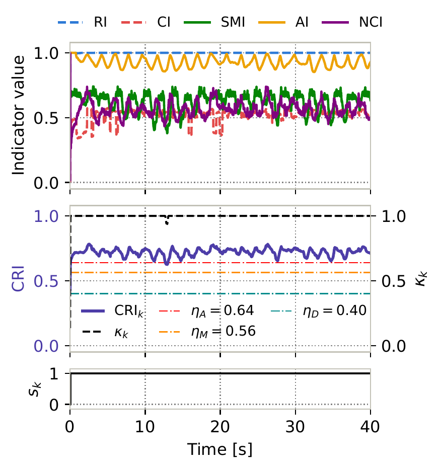

*The signature figure (Fig. 4 of the paper): operating stress, the five readiness indicators, the
combined CRI with its Activate/Monitor/Delay/Reject decision regions, and the resulting activation
signal -- all for the nominal case (S1).*

## Case Study

The framework is demonstrated on a converter-dominated hybrid AC/DC microgrid: two coordinated
VSCs on a shared DC link, each feeding an AC bus, with a CRI-supervised OFO setpoint coordinator
as the candidate controller and a conventional droop/PI controller as the fallback.

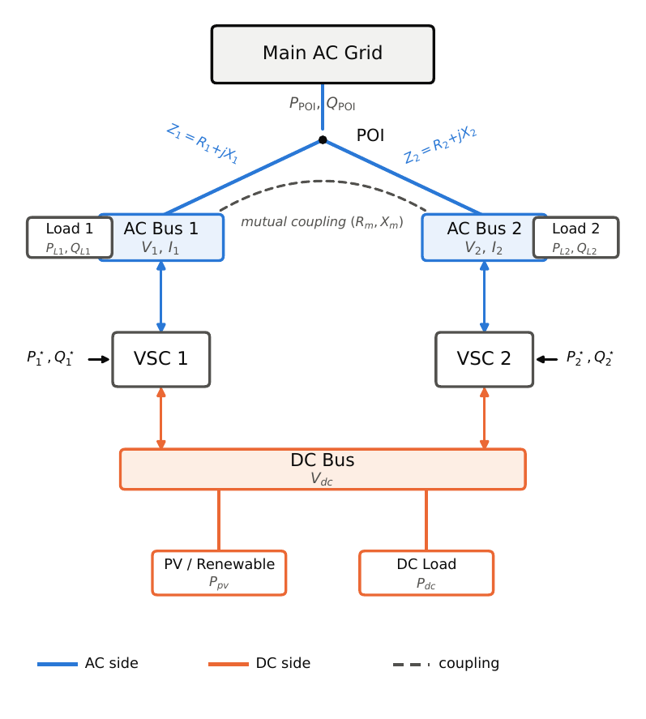

*Fig. 3 of the paper: the two-VSC hybrid AC/DC microgrid topology used throughout every scenario.*

## Key Results

All numbers below are quoted directly from the current manuscript (Section 7, Results and
Discussion) and are reproducible from `results/*.csv` via the corresponding notebook.

| Scenario | Headline finding |
|---|---|
| **S1 -- Nominal** | RI≈1, AI>0.85, with CI/SMI/NCI at a healthy 0.5-0.75; mean CRI=0.72 stays comfortably above $\eta_A=0.64$, giving continuous activation (99.85% availability) with **zero false activations** |
| **S2 -- Constraint-limited** | As load ramps ($t=6$-$34$ s) toward the voltage/current limits, SMI collapses from 0.74 to 0.06, pulling CRI from 0.78 to 0.43 -- the supervisor spends 47.9% of the run in Monitor, briefly touches Delay, and never Rejects |
| **Safe-probing verification (S2)** | Whenever probing occurs (1228 of 2001 steps), the probe amplitude tracks SMI with correlation **>0.9999**, and every probed sample satisfies the safety bound with **zero violations** |
| **S3 -- Weak actuator authority** | Under a symmetric loss of actuator authority, RI falls from 0.97 to 0.81 (min 0.66); CRI-supervised activation cuts false activations to **9**, vs. 1411 (Direct) and 186 (Threshold) |
| **S5 -- Fast drift** | Mean AI falls monotonically with drift speed: 0.95 (normal) -> 0.84 (fast) -> 0.79 (very fast); false activations: **499** (CRI) vs. 1570 (Direct) and 1131 (Threshold) |
| **S6 -- Noise confidence** | NCI collapses from 0.57 to under $10^{-3}$ by 1% measurement noise while SMI stays in a healthy 0.46-0.68 band and RI≡1.0 -- each indicator responds to its own targeted failure mode |
| **S7 -- Topology change (full VSC2 outage)** | Sensitivity matrix reshapes immediately (largest element change 1.86); RI collapses 1.00->0.00 and CI 0.52->0.00; CRI detects and rejects within **60 ms**. A genuine hazard: direct activation is falsely active for the entire post-event window (**1101** false activations) vs. just 2 (Threshold) and 5 (CRI) |
| **S8 -- Combined severe case** | CRI drops activation to 0 within **0.38 s** and never returns (vs. 16.70 s Threshold, 50.02 s Direct); false activations cut from 2501 (Direct) and 835 (Threshold) to just **19** (CRI) |
| **All 8 scenarios, aggregate** | Mean false-activation count: **66.5 (CRI)** vs. 822.9 (Direct) vs. 269.3 (Threshold) -- a **12.4x** reduction vs. Direct and **4.0x** vs. Threshold; mean unsafe-active fraction: **5.8% (CRI)** vs. 50.0% (Direct) vs. 16.8% (Threshold) |

<p align="center">
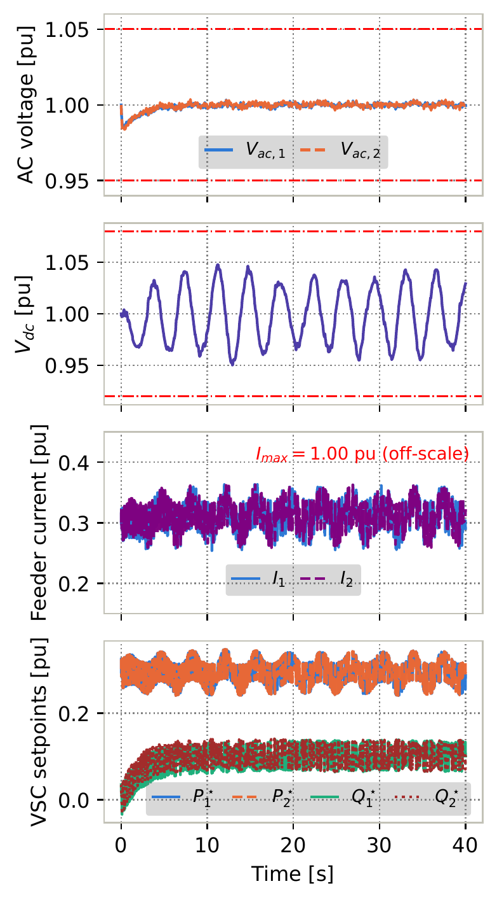
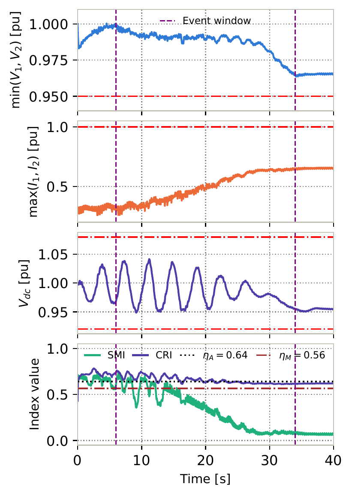
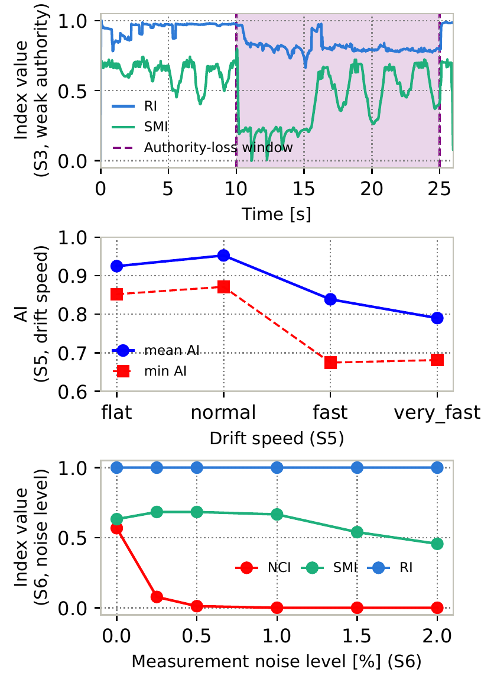
</p>
<p align="center">
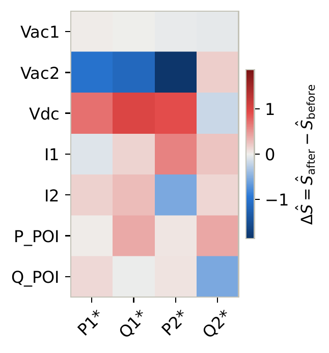
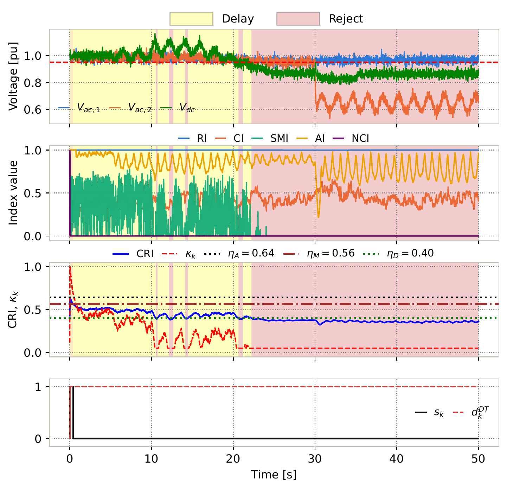
</p>

**Table 4 of the manuscript** -- Comparison of Controller-Activation Strategies (S8, combined severe case):

| Method | $E_V$ | $E_I$ | $N_{FA}$ | $T_{on}$ [s] |
|---|---|---|---|---|
| Direct activation | 0.1559 | 0.0000 | 2501 | 50.02 |
| Threshold-based activation | 0.1663 | 0.0000 | 835 | 16.70 |
| **CRI-based activation** | 0.1688 | 0.0000 | **19** | **0.38** |

Voltage-regulation quality ($E_V$) is comparable across all three strategies, and no strategy ever
reaches the current limit ($E_I=0$) in this scenario -- the entire safety benefit comes from *when*
the candidate controller is allowed to act, at essentially no cost to control quality when it does.
Across all eight scenarios, every strategy correctly reaches zero false activations in the four
scenarios with no genuine hazard (S1, S2, S4, S6), confirming the CRI does not unnecessarily
withhold activation when conditions are safe.

## Data-Calibrated CRI (DC-CRI): LOSO Calibration and Risk-Aware Deployment

EC-CRI's five weights $\omega_i$ and three decision thresholds $\eta_A,\eta_M,\eta_D$ are hand-set
engineering defaults. **DC-CRI** calibrates the same quantities directly from closed-loop data,
under an explicit activation-risk tolerance $\epsilon_{\mathrm{risk}}$ and a finite verification
horizon $T_H$, then evaluates the result on genuinely unseen operating conditions -- new module
`cri_microgrid/dc_calibration.py`, new notebooks `13_dc_cri_loso.ipynb` and
`14_dc_cri_sensitivity.ipynb`; `cri.py`, `sim.py`, and every EC-CRI notebook are unchanged.

**Calibration in one paragraph.** For a finite horizon $H$ (samples), a hard-limit hazard label
$z_k^{(H)}=1$ iff any of the next $H$ samples violates a voltage/current/DC-link limit. Weights
$\boldsymbol\omega$ are fit by a small regularized least-squares QP so that $\mathrm{CRI}_k$ tracks
$1$ on safe samples and is penalized on hazardous ones ($\lambda_H$-weighted). The activation
threshold $\eta_A^\star$ is then chosen, by a grid search, to **maximize controller availability
subject to the achieved activation risk staying at or below $\epsilon_{\mathrm{risk}}$** -- the risk
tolerance is a hard constraint, not a soft preference. Monitor/Delay margins $\eta_M,\eta_D$ are set
below $\eta_A^\star$ exactly as in EC-CRI. All of this is a pure offline post-processing step on
logged $(\Gamma_k, z_k^{(H)})$ data -- the online `CRISupervisor` architecture itself is completely
unchanged; DC-CRI is only a different `CRIParams`.

**Validation protocol: 8-fold leave-one-scenario-out (LOSO).** For each of the eight scenarios in
turn, DC-CRI is calibrated **only** on trajectory data from the other seven, then evaluated with a
genuinely fresh closed-loop simulation on the held-out scenario -- the calibration procedure never
sees the scenario it is scored on. This is the central test of the whole DC-CRI study, and it is run
at the principal settings ($\epsilon_{\mathrm{risk}}=0.01$, $T_H=0.5$ s, $\lambda_H=2.0$) as well as
across three risk tolerances and three additional horizons, to characterize the resulting
engineering trade-offs rather than report one number in isolation.

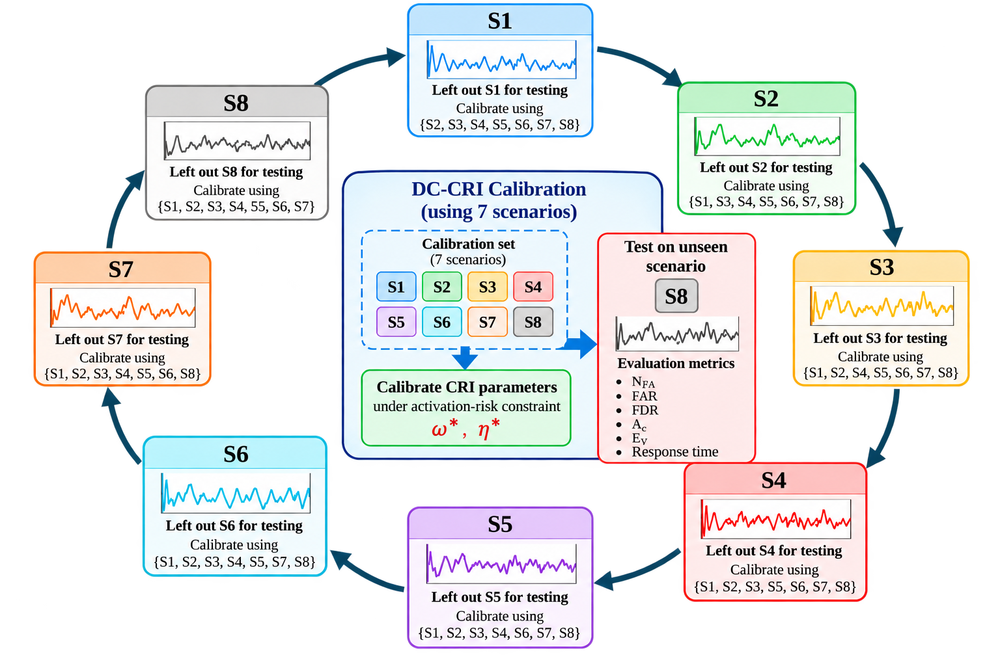

*At each fold, seven scenarios are used exclusively for parameter calibration and the remaining
scenario is retained for unseen evaluation; the procedure repeats until every scenario has served
once as the held-out test case.*

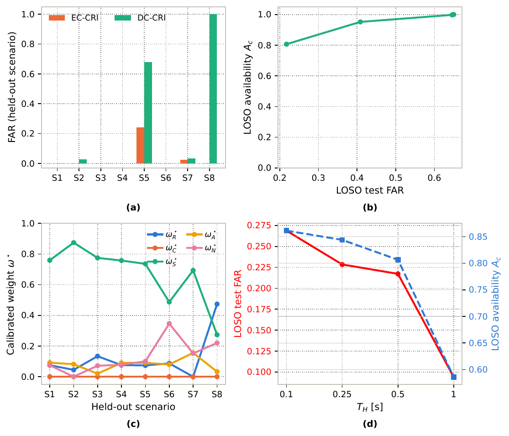

*(a) Out-of-scenario false-activation rate (FAR) by held-out scenario, EC-CRI vs. DC-CRI. (b)
LOSO-aggregate availability vs. FAR across four tested risk tolerances $\epsilon_{\mathrm{risk}}$.
(c) The five calibrated weights across all eight LOSO folds -- the coupling weight $\omega_C^\star$
calibrates to exactly zero in every fold; the safety-margin weight $\omega_S^\star$ dominates in
seven of eight. (d) LOSO-aggregate FAR and availability across four tested verification horizons
$T_H$.*

**Headline LOSO result** (all 8 folds, $\epsilon_{\mathrm{risk}}=0.01$, $T_H=0.5$ s; each held-out
scenario averaged over its own evaluation seeds first, then the 8 scenario-level values averaged
with equal weight -- source: `results/results_dc_cri_loso_aggregate.csv`):

| Method | $N_{FA}$ | FAR | FDR | $A_c$ | $E_V$ |
|---|---|---|---|---|---|
| Direct activation | 794.9 | 0.500 | 0.000 | 1.000 | 0.043 |
| Hard-limit supervisor | 222.1 | 0.142 | 0.022 | 0.756 | 0.044 |
| EC-CRI | 6.1 | 0.033 | 0.247 | 0.683 | 0.046 |
| **DC-CRI** | 374.3 | 0.217 | **0.054** | **0.806** | 0.048 |

At this risk tolerance, DC-CRI is less over-conservative than EC-CRI (FDR $0.05$ vs. $0.25$ -- EC-CRI
withholds activation during genuinely safe conditions roughly a quarter of the time) and reaches
$12$ percentage points higher controller availability ($0.806$ vs. $0.683$), while staying well
below direct activation's false-activation rate ($0.217$ vs. $0.500$). Calibration is feasible in
all **8/8** LOSO folds, and the activation-risk constraint is actively binding (not slack) in every
fold. Generalization is not uniform, however: it is strong for six of the eight held-out scenarios
(S1, S3, S4, S6, S7, and S2 to a lesser degree) and degrades specifically for the two most severe,
least-represented ones (S5, S8) -- see below.

*(Note on aggregation: S6 and S8 were evaluated over 5 seeds each (measurement noise) against 1 seed
for the other six scenarios, so each scenario's seeds are averaged first and the resulting 8
scenario-level values are then averaged with equal weight -- otherwise S6/S8 would be overweighted
5x relative to the rest. Table 7 and Table 8 below use the same convention.)*

**The honest finding, not hidden.** DC-CRI's calibration pool is dominated (>97% of pooled hazard
samples in any 7-scenario fold) by scenarios S7/S8's collapse-type hazard signature. This is not a
bug in the calibration procedure -- verified three independent ways: (1) the offline CRI
reconstruction used for calibration is bit-exact against the real online `CRISupervisor`; (2) the
effect persists across a $\lambda_H$ sweep from 2 to 50; (3) the S2-held-out failure case was traced
to a **genuine new DC-link voltage violation** ($V_{dc}$ dips to $0.918$ pu, below the $0.92$ pu
limit) that only occurs under DC-CRI's own, more permissive closed loop -- a real physical
consequence, not a labeling artifact. When a scenario's hazard mechanism is underrepresented in the
calibration pool, a threshold that satisfies its risk constraint exactly on the data it was given
can still be too permissive for that scenario -- precisely the failure mode LOSO validation exists
to expose. This directly motivated moving the principal risk tolerance from an initially-tried
$\epsilon_{\mathrm{risk}}=0.05$ (poor generalization on 5/8 folds) to $\epsilon_{\mathrm{risk}}=0.01$
(good generalization on 6/8 folds) -- the best-behaved choice among those tested, not a
retrospectively cherry-picked one.

**Risk-tolerance sensitivity** (LOSO-aggregate, mean over 8 folds; source:
`results/results_dc_cri_risk_sensitivity.csv`) -- the intended engineering trade-off, confirmed
under genuine out-of-scenario evaluation:

| $\epsilon_{\mathrm{risk}}$ | $\eta_A^\star$ | FAR | $A_c$ | FDR |
|---|---|---|---|---|
| 0.01 | $0.503\pm0.103$ | 0.217 | 0.806 | 0.054 |
| 0.025 | $0.218\pm0.080$ | 0.408 | 0.952 | 0.000 |
| 0.05 | $0.134\pm0.041$ | 0.646 | 0.998 | 0.000 |
| 0.10 | $0.119\pm0.050$ | 0.650 | 1.000 | 0.000 |

Tightening $\epsilon_{\mathrm{risk}}$ from $0.10$ to $0.01$ raises the calibrated threshold, lowers
FAR from $0.65$ to $0.22$, and reduces availability from $1.00$ to $0.81$ -- loosening it produces
the opposite pattern, exactly as intended. The relationship is not gently graded: there is a sharp
transition in $\eta_A^\star$ between $\epsilon_{\mathrm{risk}}=0.01$ and $0.025$, reflecting the
calibration pool's hazard-sample composition described above. (The $\epsilon_{\mathrm{risk}}=0.01$
row matches the headline table above exactly, since both use the same seed-averaging convention.)

**Verification-horizon sensitivity** (LOSO-aggregate, mean over 8 folds, $\epsilon_{\mathrm{risk}}=0.01$;
source: `results/results_dc_cri_horizon_sensitivity.csv`):

| $T_H$ [s] | $N_{\mathrm{FA}}$ | FAR | FDR | $A_c$ |
|---|---|---|---|---|
| 0.10 | 370.0 | 0.269 | 0.033 | 0.861 |
| 0.25 | 385.6 | 0.228 | 0.003 | 0.844 |
| 0.50 | 374.3 | 0.217 | 0.054 | 0.806 |
| 1.00 | 136.4 | 0.094 | 0.273 | 0.586 |

Longer horizons produce a more conservative threshold and lower FAR, at the cost of availability and
a rising FDR. $T_H=0.5$ s was retained as the principal setting as the point closest to the middle
of this trade-off. The $T_H=0.5$ s row matches the headline table exactly, since both describe the
same $\epsilon_{\mathrm{risk}}=0.01$, $T_H=0.5$ s point.

**Calibration feasibility and runtime** (all 8 folds, $\epsilon_{\mathrm{risk}}=0.01$; source:
`results/results_dc_cri_calibration_diagnostics.csv`): every fold is calibration-feasible (**8/8**),
the risk constraint is active in all eight, the achieved calibration-set $\widehat{\mathcal{R}}_{\mathrm{act}}$
sits within 3% relative of the $0.01$ target in every fold ($0.0097$-$0.0100$), and weight calibration itself is essentially
free as a deployment cost, completing in $2.2$-$2.9$ ms per fold ($9$-$11$ SLSQP iterations) as a
one-time offline commissioning step -- it does not affect the online per-sample CRI update time
(Sec. 11 below), which is identical for EC-CRI and DC-CRI.

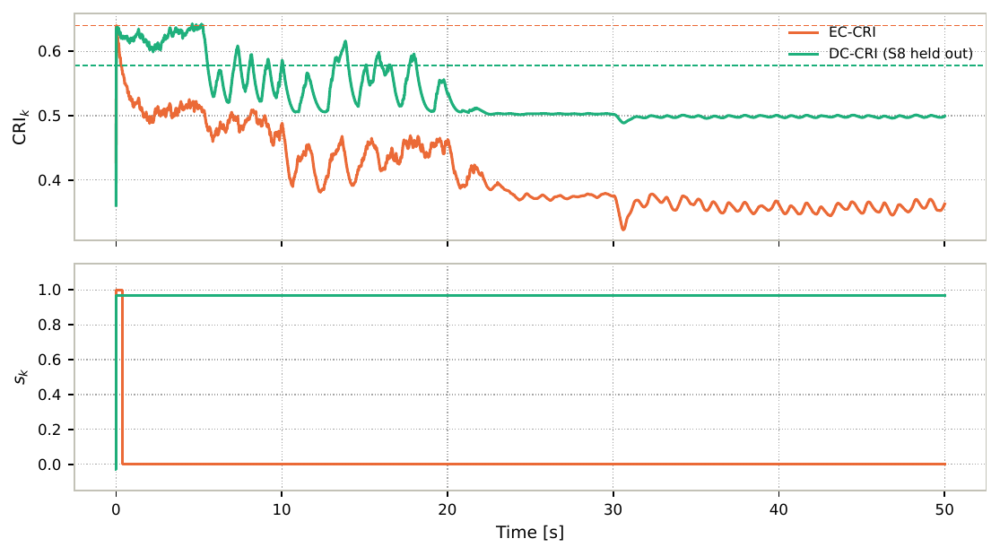

*The clearest single illustration of the generalization gap: on S8 held out from calibration,
EC-CRI's fixed threshold correctly rejects activation almost throughout (mean $s_k=0.008$), while
DC-CRI's calibrated threshold -- never having seen S8 -- remains active almost throughout (mean
$s_k=1.000$). Included deliberately as the one honestly negative result in this study: a wrong
readiness estimate transfers authority to the candidate controller; any residual protection then
depends on the fallback, which is itself not guaranteed to preserve the admissible set in this
scenario.*

| # | Notebook | Purpose | Key outputs |
|---|---|---|---|
| 13 | `dc_cri_loso` | Calibration-data generation (5 seeds x 8 scenarios) + the full 8-fold LOSO loop (Direct/Hard-limit/EC-CRI/DC-CRI on each held-out scenario) + feasibility/runtime diagnostics | `results_dc_cri_loso_folds.csv`, `results_dc_cri_loso_perscenario.csv` (+ `_summary`), `results_dc_cri_loso_aggregate.csv`, `results_dc_cri_calibration_diagnostics.csv`, `dc_cri_calibration_trajectories.npz` |
| 14 | `dc_cri_sensitivity` | Risk-tolerance sweep, horizon sweep, the multi-panel LOSO summary figure, and the representative-trajectory figure | `results_dc_cri_risk_sensitivity.csv`, `results_dc_cri_horizon_sensitivity.csv`, `Fig_dc_cri_loso_summary_V2.pdf`, `Fig_dc_cri_representative_trajectory.pdf` |

**Modeling note.** The hard operational safe set behind $z_k^{(H)}$ is defined as voltage/current/
DC-link limits only (`dc_calibration.hard_limit_violation`), not the broader authority/noise/drift
mechanism label used elsewhere for diagnostics -- actuator setpoint-box headroom is excluded because
it is already captured inside SMI, not a physical-plant-safety violation in the same sense.

Every number above is reproducible directly from `results/*.csv` via
`notebooks/13_dc_cri_loso.ipynb` and `notebooks/14_dc_cri_sensitivity.ipynb`.

## Repository Structure

```
CRI/                                # Repository root
├── README.md
├── LICENSE.txt
├── requirements.txt
├── cri_microgrid/                 # Core simulation, controller, and CRI package
│   ├── config.py                  #   PlantParams, ControllerParams, ConstraintParams, ProbeParams,
│   │                              #   ProfileParams, NoiseParams, ScenarioParams, CRIParams, SimulationParams
│   ├── plant.py                   #   HybridACDCPlant: two-VSC hybrid AC/DC plant; CRI-blind by construction
│   ├── controllers.py             #   FallbackDroopController (u_safe), OFOVSCController (candidate), blend_command
│   ├── sensitivity.py             #   estimate_sensitivity: weighted regularized local S_hat
│   ├── probing.py                 #   Safe micro-probing, SMI-scaled amplitude, actuator-bound clipping
│   ├── cri.py                     #   The five indicators, CRI combination/filter/classification, CRISupervisor
│   ├── dc_calibration.py          #   DC-CRI weight/threshold calibration, LOSO orchestration
│   ├── interfaces.py              #   Protocols for bringing your own controller/plant (see notebook 12)
│   ├── profiles.py                #   Load/PV/drift exogenous-input building blocks
│   ├── scenarios.py               #   S1-S8 scenario builders + S10 randomized-trial builder
│   ├── sim.py                     #   run_closed_loop / run_closed_loop_generic: master closed-loop simulation
│   ├── metrics.py                 #   Readiness/activation and control/disturbance metrics (+ FAR/FDR/A_c, DC-CRI)
│   ├── timing.py                  #   Isolated CRI-update execution-time benchmarking
│   ├── validation.py              #   Simulation-only ground truth (z_k^unsafe), confusion-matrix counts
│   └── plotstyle.py               #   Shared IEEE-style figure formatting and validated color system
├── notebooks/                     # One notebook per study; each only CALLS cri_microgrid functions
│   ├── 01_nominal_readiness.ipynb  ...  10_statistics_and_complexity.ipynb
│   ├── 11_Implementation_Time.ipynb  # Isolated, real-data CRI-update timing
│   ├── 12_bring_your_own.ipynb     # Template for a new controller, plant, or hardware target
│   ├── 13_dc_cri_loso.ipynb        # DC-CRI calibration + 8-fold LOSO evaluation
│   └── 14_dc_cri_sensitivity.ipynb # Risk/horizon sensitivity + the LOSO summary and representative-trajectory figures
├── Figures/                       # All generated figures (PDF), produced by the notebooks above
├── README_Figures/                # PNG renders used in this README
└── results/                       # CSV exports of every study's numerical results
```

The manuscript source and its LaTeX-integration staging notes are maintained separately and are not
part of this code repository.

## Installation

Requires Python 3.10+.

```bash
git clone https://github.com/MustafaKamoona/CRI.git
cd CRI
pip install -r requirements.txt
```

No GPU, no external solver, no PyDAE/EMT toolchain, and no proprietary software are required --
everything runs on plain NumPy/pandas in a discrete-time, fixed-step simulation loop. Results in
this repository were produced with Python 3.10.9 and NumPy 2.2.6, as stated in the manuscript.

## Quick Start

```python
from cri_microgrid.config import (PlantParams, ControllerParams, ConstraintParams,
                                   CRIParams, ProbeParams, ProfileParams, SimulationParams)
from cri_microgrid import scenarios, sim

pp, cp, cons, crip, probep, prof = (PlantParams(), ControllerParams(), ConstraintParams(),
                                     CRIParams(), ProbeParams(), ProfileParams())
scenario = scenarios.build_S1(pp, prof, T_end=40.0)

for strategy in ["direct", "threshold", "cri"]:
    simp = SimulationParams(T_end=scenario.T_end, seed=1, strategy=strategy)
    log = sim.run_closed_loop(scenario, pp, cp, cons, crip, probep, simp)
    print(strategy, "mean CRI:", log["CRI"].mean(), " active fraction:", log["s"].mean())
```

Or open any notebook in `notebooks/` and run it top to bottom -- each is self-contained
and exports its own figures (to `Figures/`) and results (to `results/`).

## Notebooks Guide

| # | Notebook | Scenario(s) | Key outputs |
|---|---|---|---|
| 01 | `nominal_readiness` | S1 | `results_S1.csv`, `Fig_CRIDashboard.pdf`, `Fig_nominal_pu.pdf` |
| 02 | `constraint_limited` | S2 | `results_S2.csv`, `Fig_constraint_margin.pdf`, `Fig_probe_scaling.pdf` |
| 03 | `weak_authority` | S3 | `results_S3.csv`, `Fig_RI_authority.pdf` |
| 04 | `coupling_and_topology` | S4, S7 | `results_S4_S7.csv`, `Fig_Shat_heatmaps.pdf`, `Fig_topology_event.pdf` |
| 05 | `fast_drift` | S5 (normal/fast/very-fast) | `results_S5.csv`, `Fig_AI_drift.pdf` |
| 06 | `noise_confidence` | S6 (0-2% noise) | `results_S6.csv`, `Fig_NCI_noise.pdf`, `Fig_noise_surface.pdf` |
| 07 | `combined_severe` | S8 | `results_S8.csv`, `Fig_severe_dashboard.pdf` |
| 08 | `direct_vs_cri` | S1-S8, three-way comparison | `results_strategy_comparison.csv`, `results_scenario_fingerprint.csv`, `Fig_scenario_fingerprint.pdf` |
| 09 | `parameter_sensitivity` | $N\times\eta_A$, $\lambda_s\times\delta_{\max}$ sweeps + 3D surface + $\pm20\%$ threshold/weight robustness | `results_param_sweep.csv`, `results_threshold_weight_sensitivity.csv`, `Fig_parameter_heatmaps.pdf`, `Fig_readiness_surface_3d.pdf` |
| 10 | `statistics_and_complexity` | 30 randomized trials + timing sweep + 20-seed Monte Carlo over S1-S8 | `results_statistics.csv`, `results_complexity.csv`, `results_multiseed_monte_carlo.csv`, `Fig_statistics.pdf`, `Fig_complexity.pdf` |
| 11 | `Implementation_Time` | Isolated real-data timing of `CRISupervisor.step()` at case-study dimensions | `results_implementation_time_summary.csv`, `results_implementation_time_per_scenario.csv` |
| **12** | **`bring_your_own`** | Template: your controller, your plant, or a HIL/experimental target | Equations-at-a-glance, interface protocols, worked examples, and the HIL/experimental deployment guide -- see the [dedicated section](#extending-the-framework-bring-your-own-controller-plant-or-hardware) below |
| **13** | **`dc_cri_loso`** | DC-CRI weight/threshold calibration + 8-fold LOSO evaluation (S1-S8, each held out in turn) | `results_dc_cri_loso_folds.csv`, `results_dc_cri_loso_perscenario(.summary).csv`, `results_dc_cri_loso_aggregate.csv`, `results_dc_cri_calibration_diagnostics.csv` -- see [DC-CRI section](#data-calibrated-cri-dc-cri-loso-calibration-and-risk-aware-deployment) above |
| **14** | **`dc_cri_sensitivity`** | Risk-tolerance sweep ($\epsilon_{\mathrm{risk}}$) and verification-horizon sweep ($T_H$), both under full LOSO re-evaluation | `results_dc_cri_risk_sensitivity.csv`, `results_dc_cri_horizon_sensitivity.csv`, `Fig_dc_cri_loso_summary_V2.pdf`, `Fig_dc_cri_representative_trajectory.pdf` |

Every strategy comparison within a notebook uses the same random seed across `direct`,
`threshold`, and `cri` runs, so all three see an identical disturbance/noise realization -- a
fair, paired comparison throughout.

## CRI Design Parameters

The manuscript's own parameter-role table (Table 3):

| Parameter | Role | Typical Effect of Increasing It | Practical Interpretation |
|---|---|---|---|
| $N$ | Moving-window length | Smoother but slower readiness estimation | Amount of recent data used by the CRI layer |
| $\lambda_s$ | Sensitivity regularization | More robust but less sensitive estimate | Protection against ill-conditioned probing data |
| $\bar\delta_{\max}$ | Maximum probing amplitude | More informative but potentially more intrusive probing | Maximum allowed online excitation |
| $r_0$ | Responsiveness normalization | Larger value makes RI more conservative | Required local input-output authority |
| $a_0$ | Adaptability normalization | Larger value tolerates faster drift | Maximum acceptable operating-point variation |
| $\sigma_{y,0}^2$ | Noise normalization | Larger value tolerates noisier measurements | Maximum acceptable measurement-noise level |
| $\eta_A,\eta_M,\eta_D$ | Decision thresholds | Higher values make activation more conservative | Activation, monitoring, and delay boundaries |
| $\omega_i$ | CRI weights | Prioritizes selected readiness components | Application-dependent importance factors |

And the exact numeric defaults, straight from `cri_microgrid/config.py::CRIParams` -- what
produced every result in this repository:

| Parameter | Symbol | Value |
|---|---|---|
| Window length | `N` | 40 |
| Adaptability window | `Na` | 20 |
| Sensitivity regularization | `lambda_s` | 1e-3 |
| Responsiveness normalization | `r0` | 0.06 |
| Adaptability normalization | `a0` | 0.12 |
| Noise normalization | `sigma_y0_sq` | 3e-3 |
| Residual normalization | `epsilon_0s` | 0.50 |
| CRI weights | `omega_R,C,S,A,N` | 0.20, 0.10, 0.30, 0.15, 0.25 |
| Activate / Monitor / Delay thresholds | `eta_A, eta_M, eta_D` | 0.64, 0.565, 0.40 |
| DT-escalation thresholds | `eta_S, eta_N` | 0.30, 0.35 |
| Dynamic-filter bounds | `beta_min, beta_max` | 0.05, 0.50 |
| Beta-noise sensitivity | `kappa_beta` | 2.0 |
| Min adaptation scaling | `kappa_min` | 0.05 |
| Max probing amplitude | `delta_max` | 0.05 pu |

## Extending the Framework: Bring Your Own Controller, Plant, or Hardware

`notebooks/12_bring_your_own.ipynb` is a complete, standalone template for putting the
CRI engine to work beyond this paper's microgrid case study -- for any development, design, or
engineering team building their own controller, plant model, or hardware deployment. It ships with
full worked examples, and this section summarizes its content end to end.

### Two levels of reuse

| You want to... | Use | What you provide |
|---|---|---|
| Test a *new candidate controller* (your optimizer/RL/MPC/PSO tuner) on the reference microgrid | `sim.run_closed_loop(..., candidate=your_controller)` | An object satisfying `CandidateControllerProtocol` |
| Test the CRI framework on an *entirely different plant* | `sim.run_closed_loop_generic(...)` | Objects satisfying `PlantProtocol`, `CandidateControllerProtocol`, `FallbackControllerProtocol`, plus a margin function |

### Interface contract

The three `typing.Protocol`s in `cri_microgrid/interfaces.py` are the entire integration surface;
nothing else in `cri_microgrid` needs to change.

| Protocol | Required methods | Used for |
|---|---|---|
| `CandidateControllerProtocol` | `candidate_command()`, `propose_nominal_step(y_meas)`, `shadow_update(delta_nominal, kappa_k)`, `reset(u0=None)` | Your optimizer, RL policy, PSO/HHO tuner, or neural adaptive controller |
| `FallbackControllerProtocol` | `command(y_meas)` | The conservative fallback controller used whenever $s_k=0$ |
| `PlantProtocol` | `measure(exo, noise_cfg=None)`, `step(u, t, exo, actuator_gain, topo, noise_cfg=None)` | Your simulated (or, for HIL, your interfaced real-time) system |

`interfaces.check_interfaces(candidate=..., fallback=..., plant=...)` validates any subset before a
run starts, raising a clear error naming exactly which method is missing.

### From simulation to hardware-in-the-loop and experimental validation

The same CRI engine -- unchanged -- carries forward through progressively more realistic execution
environments, so a team can move from a pure software study to a physical deployment without
rewriting the readiness layer at any stage:

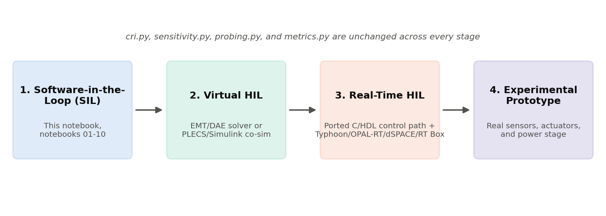

| Stage | What runs | What changes | What stays identical |
|---|---|---|---|
| **1. Software-in-the-loop (SIL)** | Everything in Python, as demonstrated in notebook 12 | Nothing -- this is the reference implementation | -- |
| **2. Virtual HIL** | A higher-fidelity plant model (EMT/DAE solver, PLECS/Simulink co-simulation, or a switched-converter model) | Only `PlantProtocol.measure()`/`step()` | `cri.py`, `sensitivity.py`, `probing.py`, `metrics.py`, and every notebook's analysis code |
| **3. Real-time HIL** | The control path ported to run within a fixed real-time step on a DSP/FPGA, exchanging I/O with a real-time-simulated power stage (Typhoon HIL, OPAL-RT, dSPACE, PLECS RT Box, Speedgoat) | Control-path functions re-implemented in C/HDL | The same five indicators, combination/filter/classification logic, and safe-probing law -- ported line-for-line |
| **4. Experimental prototype** | The ported controller driving a real (scaled or full-power) physical system | Sensors/ADC replace `noise_cfg`; actuator saturation is physical | The log schema, so `metrics.py` and every plotting routine work unchanged on hardware data |

**Real-time readiness, by construction.** Every equation in the framework is a small,
self-contained, constant-time operation -- no history replay, no iterative solver, no dynamically
sized state. The dominant cost is the regularized sensitivity estimate, with complexity
$\mathcal{O}(n_yn_uN+n_u^2N+n_u^3)$ (Eq. 61); every other indicator and decision step is vector
arithmetic and threshold comparisons. Measured directly with real closed-loop data at the exact
case-study dimensions (`notebooks/11_Implementation_Time.ipynb`), one full `CRISupervisor.step()`
costs a mean of $0.23$~ms (maximum $0.86$~ms across all eight scenarios) against a $20$~ms
sampling interval -- see that notebook for the full breakdown, `notebooks/10_statistics_and_complexity.ipynb`
for the synthetic-data $N$/$n_u$ complexity sweep, and notebook 12's real-time porting checklist
for the concrete C/HDL porting steps (isolating `CRISupervisor.step()`, fixed- vs. floating-point
choices, WCET re-verification on the actual target, and re-deriving `D_u`, `D_y`, and the decision
thresholds for a differently scaled plant).

**Suggested validation sequence**, mapped to concrete CRI artifacts at every stage:

| Stage | What it validates | CRI-specific artifact to produce |
|---|---|---|
| 1. Software-in-the-loop (this repository) | The readiness logic itself, across all eight stress scenarios | `results/*.csv`, the eight scenario notebooks |
| 2. Processor-in-the-loop (PIL) | The ported C/HDL control path's numerical agreement with this Python reference | A per-sample diff of `RI, CI, SMI, AI, NCI, CRI, s, kappa` on an identical input trajectory |
| 3. Power-HIL | Real PWM, deadtime, and switching-level behavior | The same dashboard figures as notebooks 01-08, regenerated from HIL-logged data |
| 4. Scaled hardware prototype | The full eight-scenario test matrix on a reduced-power physical system | A Direct / Threshold / CRI three-way comparison on real hardware |
| 5. Field pilot | End-to-end operation with the safety fallback wired to a real fault/watchdog signal | Continuous logging of `s_k`, `kappa_k`, `cls_code`, `dt_flag` against the deployed system's own SCADA/event log |

**A hardware-compatible log schema.** `sim.run_closed_loop`'s log dictionary (`LOG_FIELDS` in
`sim.py`) is the schema every plotting routine and every function in `metrics.py` already expects.
Logging real hardware data under the same field names -- time and decision (`t, s, kappa, cls_code,
dt_flag`), indicators (`CRI, CRI_hat, RI, CI, SMI, AI, NCI, beta`), sensitivity diagnostics
(`epsilon_s, rho, condition_number, excitation_energy, sigma_hat_sq, a_raw`), probing (`probe_bar,
probe_norm`), plus your own measurement/command channels and `execution_time` -- means the exact
same analysis code runs unmodified on experimental data.

### Parameter re-tuning notes for a new plant

Two calibration properties carry over to any new deployment, documented directly in
`cri_microgrid/config.py` and demonstrated in notebook 12:

- **SMI has a structural ceiling** whenever it is a `min` of several headroom fractions that sum to
  a fixed budget -- calibrate `eta_A`/`eta_M`/`eta_D` against your own plant's achievable *nominal*
  CRI rather than against 1.0, the same way this study's thresholds were calibrated against its own
  ~0.7 nominal ceiling.
- **RI is a scalar aggregate.** On a multi-actuator plant, a healthy channel can mask a degraded one
  in the aggregate sensitivity energy alone -- NCI and SMI typically catch what RI alone misses (see
  scenario S3 in notebook 08 for a worked example on the reference microgrid).

## Supplementary Material

Beyond the manuscript's ten main-text figures, the notebooks in this repository produce a
complete set of supplementary results:

| Material | Notebook | Description |
|---|---|---|
| Safe-probing scaling-law verification | 02 | Direct scatter-plot verification of $\bar\delta_k=\bar\delta_{\max}\mathrm{SMI}_k$ (Eq. 17) against the $y=x$ bound |
| All-scenario strategy comparison | 08 | Direct / Threshold / CRI compared across all eight scenarios in one figure |
| Scenario fingerprint | 08 | A heatmap summarizing every scenario's indicator profile side by side |
| Parameter-sensitivity heatmaps | 09 | $N\times\eta_A$ and $\lambda_s\times\bar\delta_{\max}$ design-tradeoff sweeps, plus a $\pm20\%$ threshold/weight robustness check |
| 3D readiness surface | 09 | CRI as a function of (SMI, NCI), holding RI/CI/AI fixed at representative values |
| Statistical validation | 10 | 30 randomized trials over load/parameter/noise conditions, plus a 20-seed Monte Carlo repeat of S1-S8 |
| Computational-complexity sweep | 10 | Measured timing vs. window length $N$ and input dimension $n_u$ |
| Implementation time | 11 | Isolated, real-data timing of one full `CRISupervisor.step()` on the actual case-study dimensions |
| Bring-your-own template | 12 | Full worked examples plus the HIL/experimental deployment guide above |

<p align="center">
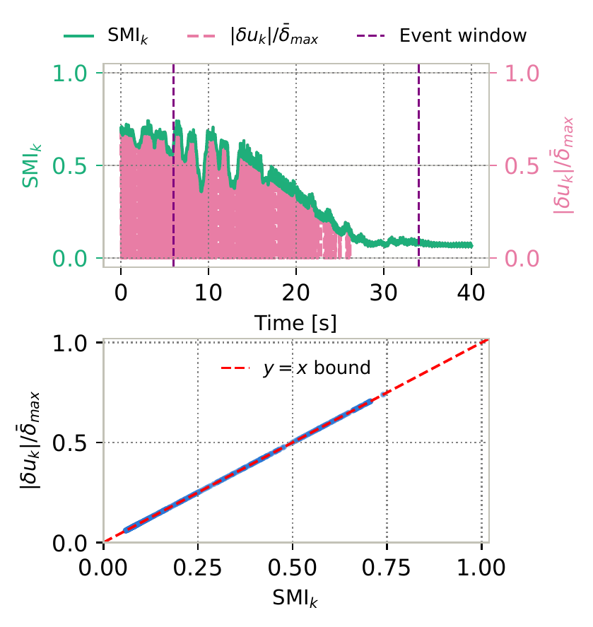
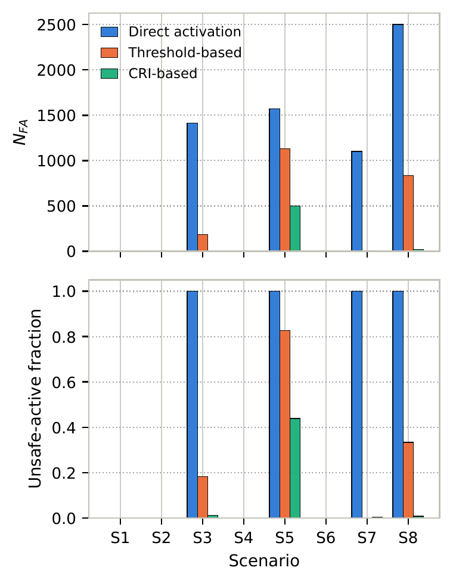
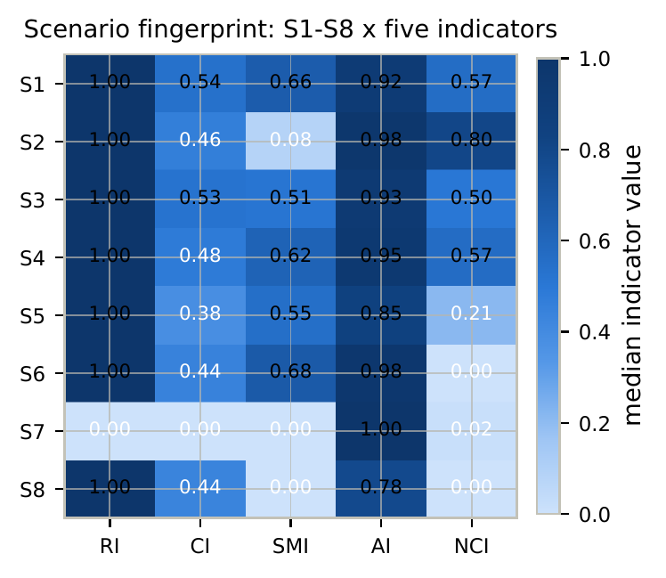
</p>
<p align="center">
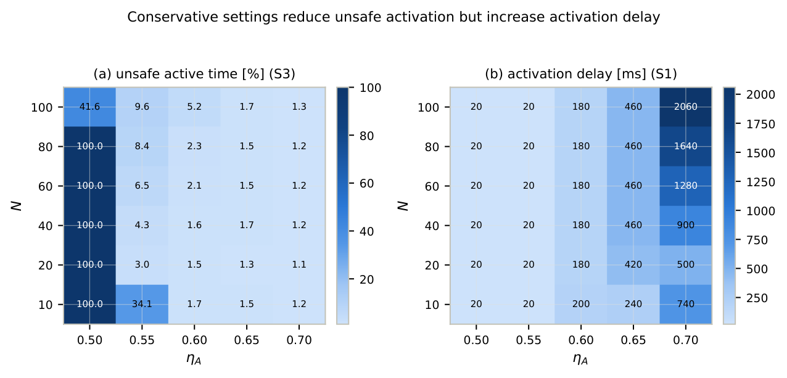
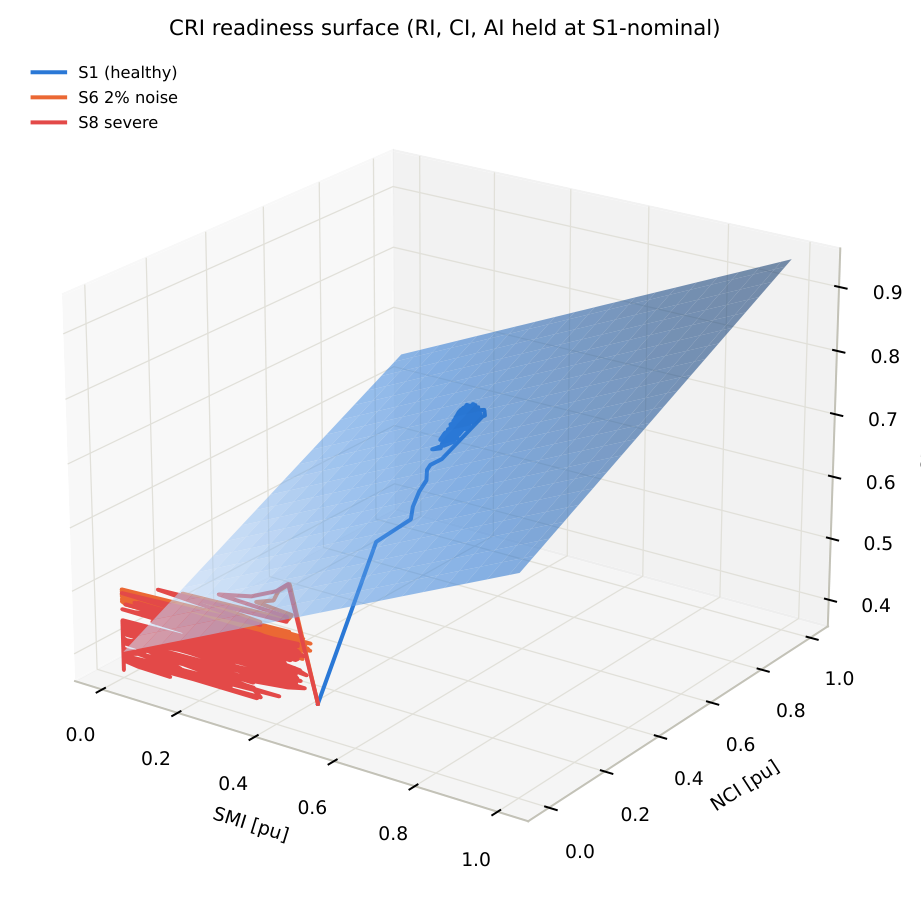
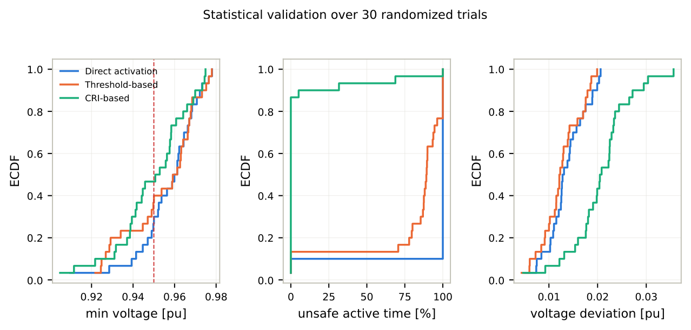
</p>

## License

This repository is released under the [MIT License](LICENSE.txt).

## Acknowledgments

This work was supported by the Ministerio de Ciencia e Innovación (MCIN), Agencia Estatal de
Investigación (AEI), 10.13039/501100011033, through the European Regional Development Fund (ERDF),
"A way of making Europe," under Grant PID2021-124571OB-I00; by CDTI under Project Ad-Grhid
MIG-20221009, 127835OB-I00; and by the European Commission through the projects COCOON (COoperative
Cyber prOtectiON for modern power grids) under Grant 101120221 and SUNRISE under Grant 101079200.

## Contact

**Mustafa A. Kamoona** -- Department of Electrical Engineering, Universidad de Sevilla, Seville, Spain
Corresponding author: muskam@alum.us.es, mustafazzasim@gmail.com

**Juan Manuel Mauricio** -- Department of Electrical Engineering, Universidad de Sevilla, Seville, Spain

For questions, issues, or collaboration inquiries, please open a GitHub issue on this repository.
